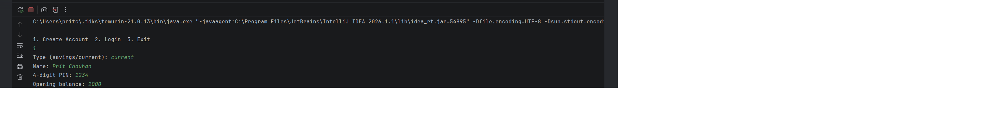
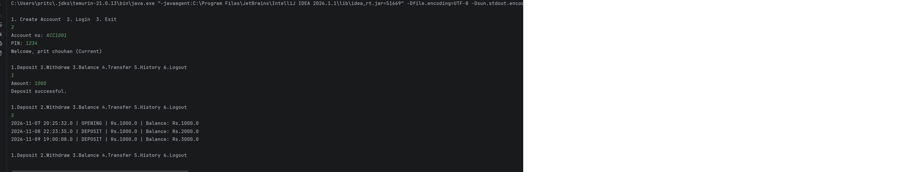
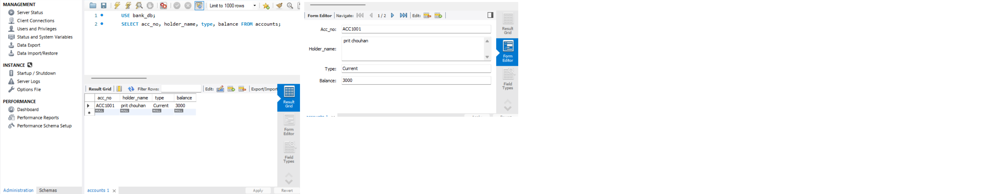

# Bank Management System

A console-based banking application built in **Java** using **OOP principles**, with data stored permanently in **MySQL** through **JDBC**. It supports savings and current accounts, PIN login, deposits, withdrawals, fund transfers and transaction history.

## Features

- Create **Savings** or **Current** accounts with an auto-generated account number (ACC1001, ACC1002, ...)
- Secure login with account number and PIN
- Deposit, withdraw and check balance
- Transfer money between accounts
- Full transaction history for every account
- Input validation (no negative amounts, unknown receiver, same-account transfer)
- Account-specific rules:
  - **Savings:** must maintain a minimum balance of Rs. 500
  - **Current:** allows an overdraft up to Rs. 5,000
- Data persists after the program is closed

## Tech Stack

| Area | Technology |
|---|---|
| Language | Java 21 |
| Build tool | Maven |
| Database | MySQL 8 |
| DB access | JDBC (PreparedStatement) |
| IDE | IntelliJ IDEA |

## OOP Concepts Used

| Concept | Where |
|---|---|
| Abstraction | `Account` is an abstract class with abstract `withdraw()` and `getType()` |
| Inheritance | `SavingsAccount` and `CurrentAccount` extend `Account` |
| Polymorphism | `withdraw()` behaves differently for each account type |
| Encapsulation | Private fields (PIN, account number) with controlled access via methods |
| Custom exception | `InsufficientBalanceException` |
| Collections | `List<Transaction>` for history |

## Database Design

- **accounts**: `acc_no` (PK), `holder_name`, `pin`, `type`, `balance`
- **transactions**: `id` (PK), `acc_no` (FK), `type`, `amount`, `balance_after`, `created_at`

Fund transfers use **JDBC transactions** (`setAutoCommit(false)`, `commit()`, `rollback()`), so the debit and credit either both succeed or both fail. All queries use `PreparedStatement` to prevent SQL injection.

## Project Structure

```
src/main/java
 ├── model/        Account, SavingsAccount, CurrentAccount, Transaction
 ├── exception/    InsufficientBalanceException
 ├── dao/          DBConnection, AccountDAO
 ├── service/      BankService (business logic)
 └── Main.java     Console menu
database.sql       Database and table creation script
pom.xml
```

## How to Run

**Prerequisites:** JDK 21, Maven, MySQL Server 8, IntelliJ IDEA (or any Java IDE)

1. **Clone the repository**
   ```
   git clone https://github.com/<your-username>/bank-management-system.git
   ```
2. **Create the database:** open MySQL Workbench and run the script in `database.sql`
3. **Set your MySQL password:** open `src/main/java/dao/DBConnection.java` and change:
   ```java
   private static final String PASSWORD = "your_password";
   ```
4. **Load dependencies:** open the project in IntelliJ and click **Reload** in the Maven panel
5. **Run** `Main.java`

## Sample Usage

```
1. Create Account  2. Login  3. Exit
> 1
Type (savings/current): savings
Name: Rahul
4-digit PIN: 1234
Opening balance: 5000
Account created! Your number: ACC1001
```

## Screenshots

> Add 2 to 3 screenshots here (account creation, customer menu, transaction history, MySQL tables)





## Future Improvements

- Hash PINs with BCrypt instead of storing plain text
- Admin login to view all accounts
- Interest calculation for savings accounts
- JUnit tests for the model and service layers
- Swing/JavaFX GUI or a Spring Boot web version

## Author

**Prit Chouhan**
GitHub: [PritChouhan-18](https://github.com/PritChouhan-18) 
LinkedIn: [your-profile](https://www.linkedin.com/in/Prit_Chouhan)